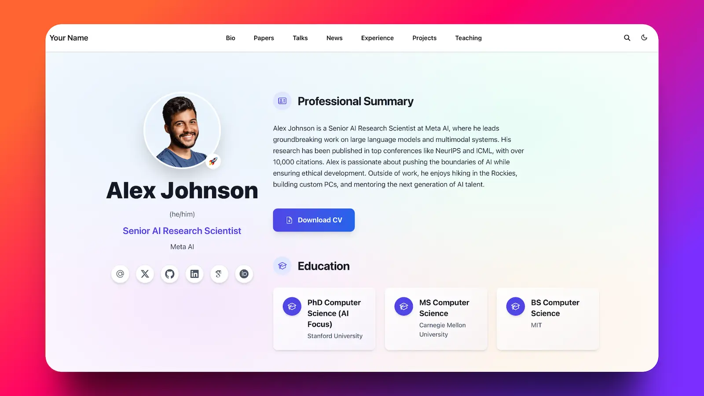

# 贾豪睿 · Haorui Jia 的个人主页

基于 HugoBlox Academic CV 模板，默认中文，提供英文版本。中文路径为 `/`，英文路径为 `/en/`。

## 日常修改哪些文件

| 内容 | 文件 |
| --- | --- |
| 中文姓名、简介、学校、研究兴趣、教育经历和联系方式 | `data/authors/me.yaml` |
| 对应英文资料 | `data/en/authors/me.yaml` |
| 中文首页栏目、标题和联系文字 | `content/zh/_index.md` |
| 英文首页栏目、标题和联系文字 | `content/en/_index.md` |
| 中英文导航、网站标题和搜索引擎简介 | `config/_default/languages.yaml` |
| 默认语言、正式网址 | `config/_default/hugo.yaml` |
| 外观、明暗模式、页脚 | `config/_default/params.yaml` |

头像可放在 `assets/media/authors/me.jpg` 或 `me.png`，无需头像时可留空。添加照片时只保留一个同名图片文件。当前没有简历下载按钮；准备好真实简历后再添加。

当前主页只显示简介、研究兴趣、教育经历及联系信息，不需要补齐论文、奖项或项目。
原模板的 `content/blog/`、`content/projects/`、`content/publications/` 等文件和 `content/_index.md` 保留作格式参考；**网站只读取 `content/zh/` 和 `content/en/`，这些示例不会发布**。以后增加内容，请放入对应语言目录，并同步调整两种语言的导航与首页栏目。

## 预览与部署

使用 `hugoblox.yaml` 指定的 Hugo Extended 版本（当前为 0.162.0）、Go 和 Node.js 22，以及 `package.json` 指定的 pnpm：

```bash
pnpm install --frozen-lockfile
pnpm dev
```

生产构建：`pnpm build`。

已有 `.github/workflows/deploy.yml` 会在代码推送到 `main` 后运行 GitHub Pages 部署。仓库 Pages 的发布来源应设为 GitHub Actions；构建与部署成功后，正式地址为 https://jarhray.github.io/ 。本地修改本身不会发布网站。

双语作者资料机制见 [HugoBlox 作者文档](https://hugoblox.com/docs/guide/building/authors)，多语言配置见 [Hugo 文档](https://gohugo.io/content-management/multilingual/)。

---

以下为原模板说明。

# [The Academic CV That Gets You Hired](https://github.com/HugoBlox/hugo-theme-academic-cv)

[](https://hugoblox.com/templates/academic-cv?utm_source=github&utm_medium=readme&utm_content=preview)

<!-- TODO: Replace with a short demo video showing Hugo Chat generating an academic profile page -->
<!-- https://github.com/user-attachments/assets/REPLACE_ME -->

<h1 align="center">The Portfolio That Works While You Sleep</h1>

<p align="center">
  <strong>Your unfair advantage in academia.</strong><br/>
  Stop sending PDFs into the void. Build a living portfolio that boosts citations, attracts collaborators, and lands offers — all from simple Markdown files you own.<br/>
  Built on <a href="https://github.com/HugoBlox/kit">HugoBlox</a> — the open-source framework where AI generates your pages and you own everything as Markdown.
</p>

<p align="center">
  <a href="https://hugoblox.com/templates/academic-cv?utm_source=github&utm_medium=readme&utm_content=cta_top"><b>Deploy Free (60s)</b></a>
  &nbsp;&nbsp;|&nbsp;&nbsp;
  <a href="https://hugo.chat/?utm_source=github&utm_medium=readme&utm_content=cta_top_academic-cv"><b>Customize with AI</b></a>
  &nbsp;&nbsp;|&nbsp;&nbsp;
  <a href="https://hugoblox.com/templates/academic-cv?utm_source=github&utm_medium=readme&utm_content=demo">Live Demo</a>
</p>

<div align="center">

  <a href="https://github.com/HugoBlox/hugo-theme-academic-cv">
    
  </a>
  <a href="https://discord.gg/z8wNYzb">
    
  </a>
  <a href="https://github.com/HugoBlox/kit">
    
  </a>

</div>

<p align="center">
  <sub>Part of the <a href="https://github.com/HugoBlox/kit"><strong>HugoBlox</strong></a> ecosystem · Trusted by <strong>150,000+</strong> researchers at <strong>MIT, Stanford, Google & NVIDIA</strong> · Rated <strong>4.9/5</strong> (official survey) · Since <strong>2016</strong></sub>
</p>

---

## Why This Template?

Most academic CVs are static PDFs that get lost in the pile. This is an **always-on portfolio** that works 24/7 to advance your career:

- **Students & grads** applying to top labs and industry roles — stand out with a living portfolio, not a flat PDF
- **Researchers** who want a citable online presence with publications, projects, and talks in one place
- **Faculty & PIs** showcasing their lab, group news, and team members
- **Anyone with publications** who wants auto-imported citations from BibTeX/DOI without manual formatting

> *"My citations went up 3x after switching to this template. Colleagues started finding my work through Google Scholar links back to my site. The BibTeX auto-sync is a lifesaver."*
> — **Dr. Li Zhang**, AI Research Scientist

> *"I set this up during a weekend and my PhD students had their profiles live by Monday. They just edit Markdown — no tickets to IT, no WordPress logins."*
> — **Prof. Sarah Chen**, Computer Science, ETH Zürich

<p align="center">
  <a href="https://hugoblox.com/templates/academic-cv?utm_source=github&utm_medium=readme&utm_content=cta_mid">
    
  </a>
</p>

---

## Features

| Feature | Benefit |
| :--- | :--- |
| **BibTeX / DOI auto-import** | Drop in a `.bib` file — publication pages generated automatically with proper citations. |
| **Jupyter & RMarkdown** | Publish `.ipynb` notebooks as beautiful posts — code, outputs, and narrative intact. |
| **LaTeX math** | Native rendering for equations and technical writing. |
| **Markdown slides** | Present with reveal.js — math, syntax highlighting, diagrams, speaker notes. |
| **SEO & AI-ready** | Optimized for search engines and LLMs — your work gets found, cited, and recommended. |
| **AI page generation** | Describe what you need to [Hugo Chat](https://hugo.chat/?utm_source=github&utm_medium=readme&utm_content=features_academic-cv) — get structured pages with correct front matter instantly. |
| **Visual editor** | Drag-and-drop blocks in VS Code with [Ownable CMS](https://marketplace.visualstudio.com/items?itemName=ownable.ownable). No coding needed. |
| **Plain Markdown** | Every file is human-readable. No database, no lock-in, take your content anywhere. |
| **Free hosting** | Deploy to GitHub Pages, Netlify, Vercel, or Cloudflare — all free tier. |

---

## 🚀 Get Started

### Step 1: Deploy Your Site

**Option A: Launch in browser** (fastest — no install needed)

> [!TIP]
> Deploy a live site in 60 seconds — no software to install:
> [**Deploy Academic CV free**](https://hugoblox.com/templates/academic-cv?utm_source=github&utm_medium=readme&utm_content=get_started)

**Option B: Use the CLI**

```bash
# Requires Hugo Extended & Node.js
npx hugoblox create site --template academic-cv
```

### Step 2: Customize With AI + Visual Editing

<table>
<tr>
<td width="50%">

**✨ Hugo Chat** — AI customization

Tell Hugo Chat what you want in plain English. It generates structured pages with the right front matter, shortcodes, and blocks for this template.

> *"Add a publications page with my 2024 papers from this BibTeX file"*

[**Try Hugo Chat — free**](https://hugo.chat/?utm_source=github&utm_medium=readme&utm_content=step2_academic-cv)

</td>
<td width="50%">

**Ownable CMS** — visual editing in VS Code

1. Install [Ownable CMS](https://marketplace.visualstudio.com/items?itemName=ownable.ownable)
2. Open your project in VS Code
3. Click the Ownable icon to start editing visually

</td>
</tr>
</table>


*Ownable CMS: Drag-and-drop page builder inside VS Code.*

> [!NOTE]
> **New to Hugo?** No problem. You don't need to know Hugo — edit visually or write Markdown. Hugo is the engine under the hood that makes your site fast, secure, and free to host. [Learn more →](https://docs.ownable.dev/?utm_source=github&utm_medium=readme&utm_content=docs_academic-cv)

---

## 💎 Go Premium

Love the free version? **Academic CV Pro** and **Resume Pro** take it further:

- Premium designs that make an unforgettable first impression
- Advanced timeline and layout options
- Full-featured course/lecture sections
- Remove attribution, priority support

| | **Academic CV** (Free) | **Academic CV Pro** |
| :--- | :---: | :---: |
| Design | Professional & clean | **Premium designs** |
| Layouts | Standard sections | **Advanced timelines** |
| Courses/lectures | Basic | **Full-featured** |
| Support | Community | **Priority** |

<p align="center">
  <a href="https://hugoblox.com/pricing?utm_source=github&utm_medium=readme&utm_content=premium_academic-cv"><b>Compare plans</b></a>
  &nbsp;&nbsp;|&nbsp;&nbsp;
  <a href="https://hugoblox.com/templates/academic-cv-pro?utm_source=github&utm_medium=readme&utm_content=premium_deploy_academic-cv"><b>Deploy Academic CV Pro</b></a>
  &nbsp;&nbsp;|&nbsp;&nbsp;
  <a href="https://hugoblox.com/templates/resume-pro?utm_source=github&utm_medium=readme&utm_content=premium_deploy_resume"><b>Deploy Resume Pro</b></a>
</p>

---

## 🏆 Why HugoBlox?

> *Why not just use WordPress, Webflow, or an AI builder like Lovable?*

| | **AI builders** (Lovable, v0) | **CMS platforms** (WordPress, Webflow) | **HugoBlox** |
| :--- | :---: | :---: | :---: |
| AI generates your pages | Yes | No | **Yes** |
| You own the output as readable files | No — React code | No — database | **Yes — Markdown** |
| Free to host forever | No | No | **Yes** |
| Human-editable without the tool | Barely | No | **Yes — it's Markdown** |
| Open source | No | No | **Yes — MIT licensed** |

> [!IMPORTANT]
> Your content is plain Markdown files. No lock-in, no database, no vendor dependency. If you ever want to leave, take your files and go.

---

## FAQ

<details>
<summary><b>Do I need to know Hugo?</b></summary>
No. Edit visually with Ownable CMS or write Markdown. Hugo is the build engine — you don't need to touch it.
</details>

<details>
<summary><b>Can I import my existing publications?</b></summary>
Yes. Drop a BibTeX file and publication pages are generated automatically with proper citations, metadata, and links.
</details>

<details>
<summary><b>Can I host for free?</b></summary>
Yes. GitHub Pages, Netlify, Vercel, and Cloudflare Pages all have free tiers for static sites.
</details>

<details>
<summary><b>Can I migrate my content later?</b></summary>
Yes. Your site is just Markdown files in a folder. Copy them anywhere.
</details>

<details>
<summary><b>What's Hugo Chat?</b></summary>
An AI assistant trained on Hugo and HugoBlox docs. Describe what you want and it generates the right pages with correct front matter. <a href="https://hugo.chat/?utm_source=github&utm_medium=readme&utm_content=faq_academic-cv">Free to try.</a>
</details>

<details>
<summary><b>Can I cancel Pro anytime?</b></summary>
Yes. No questions asked.
</details>

---

<h2 align="center">🚀 Ready to launch?</h2>

<p align="center">
  Deploy in 60 seconds. Customize with AI. Own it as Markdown forever.
</p>

<p align="center">
  <a href="https://hugoblox.com/templates/academic-cv?utm_source=github&utm_medium=readme&utm_content=cta_final"><b>Deploy Academic CV — free</b></a>
  &nbsp;&nbsp;|&nbsp;&nbsp;
  <a href="https://hugo.chat/?utm_source=github&utm_medium=readme&utm_content=cta_final_academic-cv"><b>Customize with AI</b></a>
</p>

---

## Community & Support

- 💬 [**Discord**](https://discord.gg/z8wNYzb) — ask questions, share your site
- 📚 [**Docs**](https://docs.ownable.dev/?utm_source=github&utm_medium=readme&utm_content=community_academic-cv)
- ⭐ [**Star HugoBlox**](https://github.com/HugoBlox/kit) — help others find it
- 🐦 [**Follow on X**](https://x.com/GoOwnable)

### Sponsors

[**❤️ Sponsor on GitHub**](https://github.com/sponsors/gcushen) | [**🏢 Become a Partner**](https://github.com/sponsors/gcushen)

---

Copyright 2016-present [**Lore Labs**](https://lore.tech/?utm_source=github&utm_medium=readme).
Released under the [MIT License](./LICENSE.md).

<p align="center">
  <sub>HugoBlox is a trademark of Lore Labs.</sub>
</p>

<!--START_SECTION:news-->
<!--Updated at 2026-10-04T03:18:59.979Z-->
<!--END_SECTION:news-->
